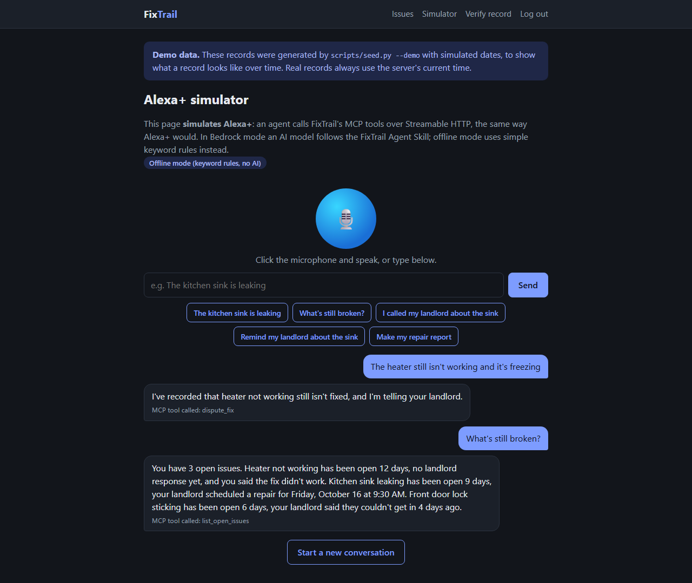
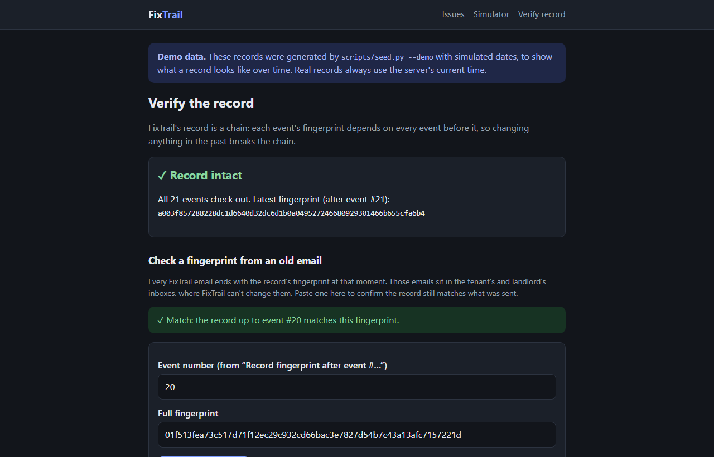
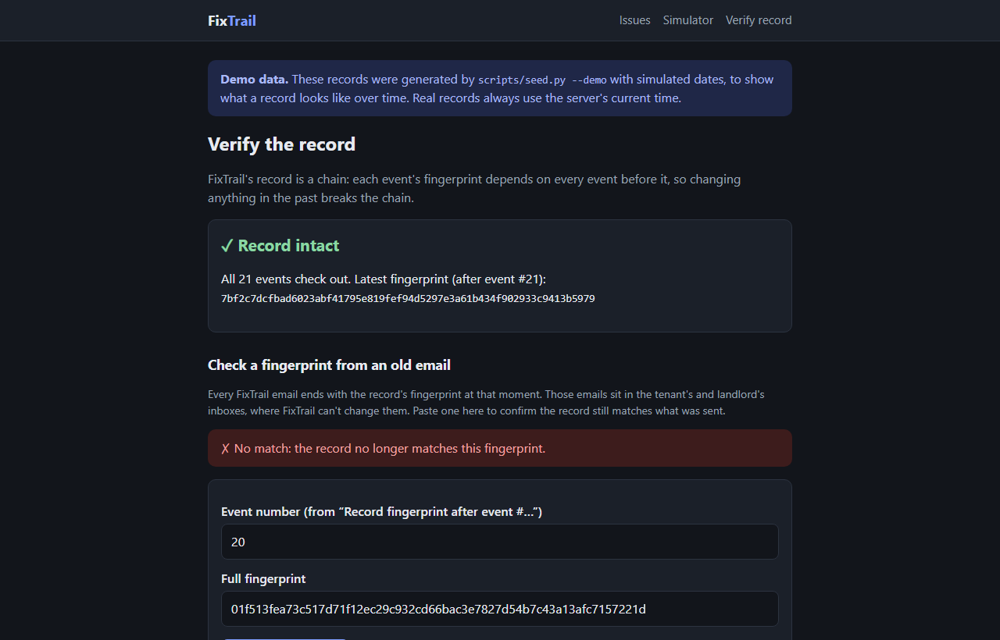
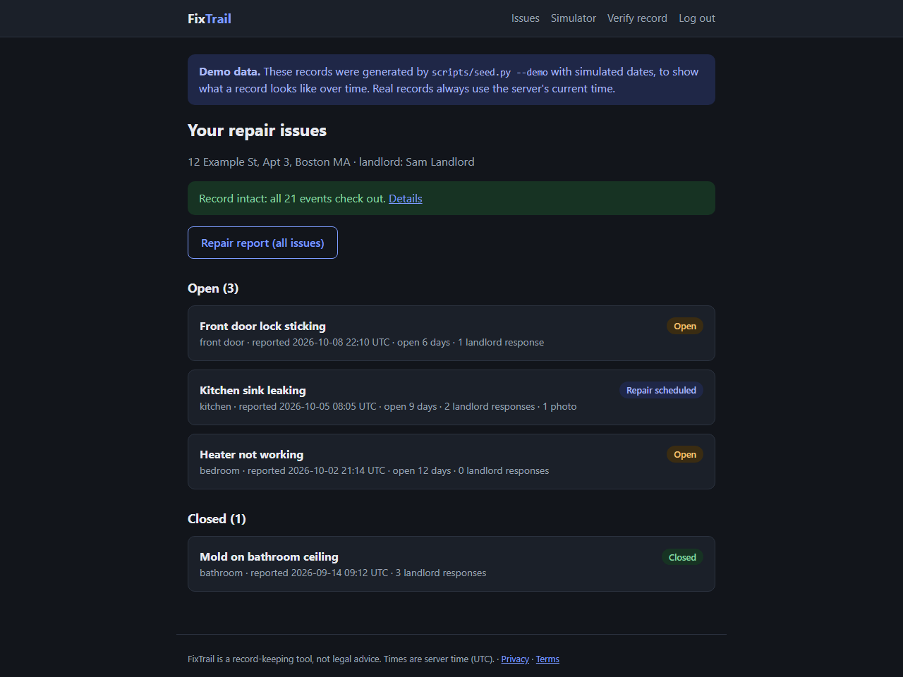
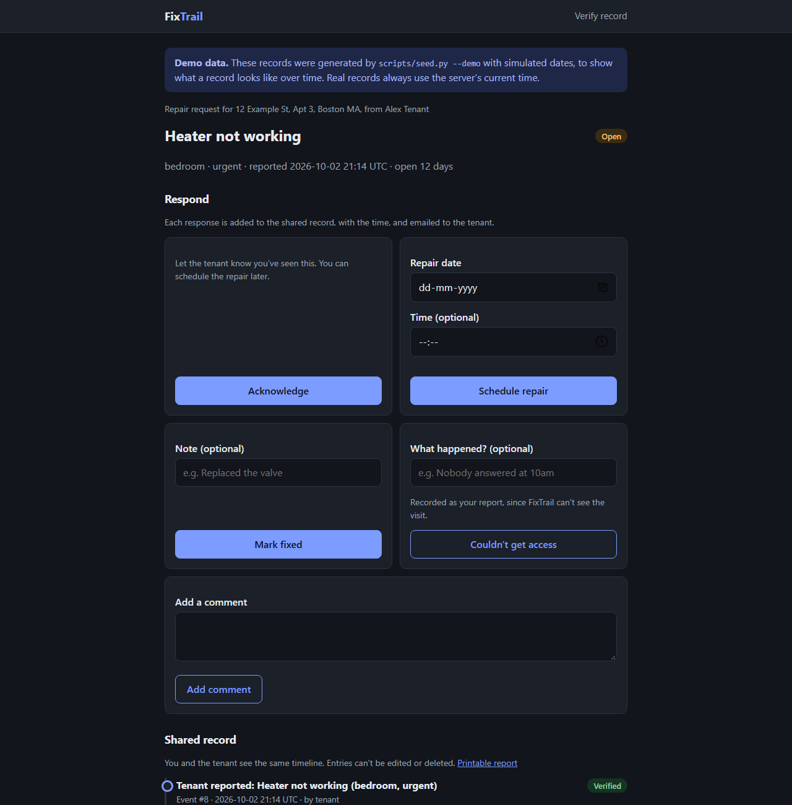
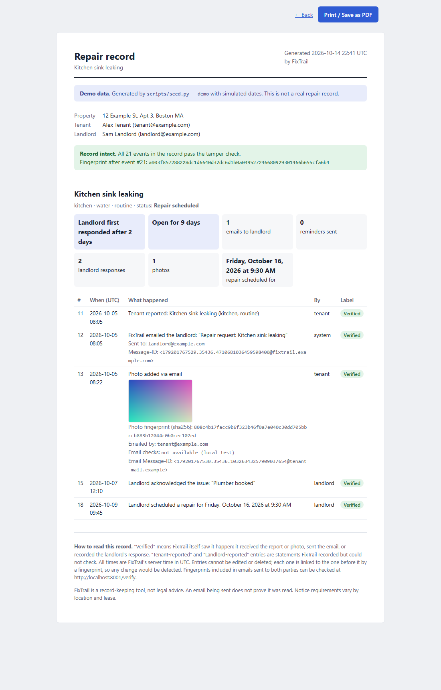

# FixTrail

**A neutral, tamper-evident repair record for renters and landlords, reported by voice.**

FixTrail is an MCP server for the **Alexa+** track of the Amazon Developer Hackathon. A tenant says
*"Alexa, the heater stopped working"*, FixTrail emails the landlord immediately, and every event goes into a shared,
append-only record that neither side, and not even FixTrail itself, can quietly rewrite.



| Track / challenge | What FixTrail provides |
|---|---|
| **Alexa+** | An MCP server over Streamable HTTP (spec 2025-11-25) with 10 tools, an [Agent Skill](skills/fixtrail/SKILL.md), and an Alexa+ simulator web app |
| **AWS Builder** | Amazon Bedrock + the Strands Agents SDK power the simulator; Amazon SES, S3, and SNS handle email and photos ([AWS.md](docs/AWS.md)) |

---

## The problem

When something breaks in a rental home, disputes follow: *"I reported this five times"* versus *"I was never told."*
Housing inspectors, mediators, and courts need dated, trustworthy records, and usually nobody has them. A tenant's
private notes are weak evidence because anyone can write anything. A useful record has to be **fair to both sides**
and **hard to fake**.

## How it works

1. **The tenant speaks.** *"The kitchen sink is leaking."* The assistant calls FixTrail's `report_issue` tool.
2. **The landlord is notified at once**, by email, with a private link to respond: acknowledge, schedule a repair,
   mark it fixed, or say they couldn't get in.
3. **Both sides add to one shared timeline.** The tenant can add photos (upload them, or simply reply to a FixTrail
   email with photos attached) and say *"I called my landlord"*, *"remind my landlord"*, or *"the sink is fixed"*.
4. **Anyone can produce a dated report** with response times, such as *"Landlord first responded after 2 days"* or
   *"No landlord response in 12 days"*.

```
 Tenant's voice
      |
 Alexa+ (or the Alexa+ simulator: Strands agent + Bedrock + FixTrail Agent Skill)
      |  MCP over Streamable HTTP
      v
 FixTrail server (Python, FastAPI)
      |-- 10 MCP tools at /mcp
      |-- web pages: tenant timeline, landlord responses, photos, reports, /verify
      |-- append-only, hash-chained event log (SQLite with triggers)
      |-- email out: local .eml files, or Amazon SES  (every email carries the record's fingerprint)
      |-- photos: local folder, or Amazon S3
      |-- photo replies by email: local inbox/ folder, or SES receiving -> S3 -> SNS -> /inbound/ses
```

## How FixTrail earns trust

**Honest labels.** Every event is marked **Verified** only if FixTrail itself saw it happen (it received the report or
photo, sent the email, or recorded the landlord's click). Things it can't see, like phone calls or a visit where
nobody answered, are labeled **Tenant-reported** or **Landlord-reported**.

**An append-only hash chain.** Each event's fingerprint (SHA-256) is computed from its contents plus the previous
event's fingerprint. Database triggers block edits and deletes, server time is used for every timestamp, and
`/verify` recomputes the whole chain.

**Witnesses outside FixTrail.** A hash chain alone can be rewritten by whoever runs the server. So every email ends
with the record's fingerprint at that moment. Those emails sit in the tenant's and landlord's inboxes, where FixTrail
can't change them. If history is rewritten, old fingerprints stop matching:

| The operator rewrites history and recomputes every hash: `/verify` still says "Record intact"... | ...but a fingerprint from an old email exposes it |
|---|---|
|  |  |

`scripts/tamper_demo.py` performs exactly this attack (with a backup and `--restore`) for the demo.

## Screenshots

| Tenant dashboard | Issue timeline with labels and an emailed photo |
|---|---|
|  |  |

| Landlord response page (no login, private link) | Printable repair report |
|---|---|
|  |  |

*Screenshots use the clearly bannered demo data from `scripts/seed.py --demo`.*

## MCP tools

| Tool | Tenant says something like | What happens |
|---|---|---|
| `report_issue` | "The kitchen sink is leaking." | Logs the issue, emails the landlord, emails the tenant a reply-with-photos address |
| `list_open_issues` | "What's still broken?" | Days open and the landlord's latest response for each issue |
| `get_issue_history` | "What happened with the heater?" | Spoken summary of one issue's timeline |
| `send_follow_up` | "Remind my landlord about the heater." | Reminder email, logged as verified |
| `log_contact_attempt` | "I called my landlord about the sink." | Logged as tenant-reported (unverified) |
| `confirm_fixed` | "The sink is fixed." | Closes the issue and tells the landlord |
| `dispute_fix` | "The heater still isn't working." | Records the dispute and tells the landlord |
| `get_photo_upload_link` | "How do I add photos?" | Emails the tenant: reply with photos, or use the upload link |
| `generate_report` | "Make my repair report." | Printable dated report; the tenant is emailed the link |
| `ping` | "Is FixTrail working?" | Health check |

Users say *"the heater"*, not an ID, so FixTrail matches everyday words (and typos) to the right issue and asks a short
question when it's ambiguous. Every reply is one or two speakable sentences, and tools answer in a few hundred
milliseconds (Alexa+ requires under 500 ms), with emails sent in the background.

**Agent Skill:** [`skills/fixtrail/SKILL.md`](skills/fixtrail/SKILL.md) follows the [Agent Skills](https://agentskills.io/)
specification and passes its reference validator. It teaches any agent which tool fits what the tenant said, how to
answer by voice, and the honesty rules (never present an unverified claim as proven; no legal advice).

**Alexa+ simulator** (`/simulator`): speak (browser speech recognition, best in Chrome or Edge) or type. A Strands agent
connects to FixTrail's `/mcp` exactly as Alexa+ would, and the transcript shows which MCP tool was called.
`SIMULATOR_MODE=bedrock` uses an Amazon Bedrock model with the Agent Skill as instructions; `offline` (the default)
uses keyword rules with the same agent loop and real MCP calls, so it works without an AWS account.

---

## Run it locally

Requires **Python 3.10 or newer** (tested with 3.12) and Git. No AWS account needed.

**Windows (PowerShell)**

```powershell
git clone https://github.com/himani-png/fixtrail.git
cd fixtrail
python -m venv .venv
.venv\Scripts\python -m pip install -r requirements.txt
copy .env.example .env
.venv\Scripts\python scripts\seed.py --demo
.venv\Scripts\python -m uvicorn app.main:app --reload
```

**macOS / Linux**

```bash
git clone https://github.com/himani-png/fixtrail.git
cd fixtrail
python3 -m venv .venv
.venv/bin/python -m pip install -r requirements.txt
cp .env.example .env
.venv/bin/python scripts/seed.py --demo
.venv/bin/python -m uvicorn app.main:app --reload
```

Then open:

| Address | What it is |
|---|---|
| http://localhost:8000 | Tenant dashboard (passcode `change-me`, set in `.env`) |
| http://localhost:8000/simulator | Alexa+ simulator: click the microphone or an example phrase |
| http://localhost:8000/verify | Check the record, or paste a fingerprint from an email in `outbox/` |
| http://localhost:8000/mcp | The MCP endpoint, for MCP Inspector or any MCP client |

Leave out `--demo` to start with an empty record. Emails are saved as `.eml` files in `outbox/`; open one and its
`/respond/...` link to act as the landlord.

### Try the scripts

Run these in a second terminal while the server is running (use `.venv/bin/python` on macOS/Linux):

```powershell
.venv\Scripts\python scripts\try_it.py            # a voice scenario over MCP, like Alexa+ would run it
.venv\Scripts\python scripts\make_test_reply.py   # a tenant replies to an email with a photo...
.venv\Scripts\python scripts\ingest_email.py      # ...and FixTrail checks and adds it
.venv\Scripts\python scripts\tamper_demo.py --yes # rewrite history; then paste the printed fingerprint at /verify
.venv\Scripts\python scripts\tamper_demo.py --restore
```

### Connect MCP Inspector

```powershell
npx @modelcontextprotocol/inspector --transport http --server-url http://localhost:8000/mcp
```

### Run the tests

```powershell
.venv\Scripts\python -m pytest -q
```

120 tests cover the hash chain and tamper detection, every tool (including real MCP calls), the web pages, photo
replies by email, the simulator's full agent loop over HTTP, the demo tools, and the AWS integrations (with botocore's
Stubber, so no AWS account is needed).

## Configuration

All settings live in `.env` (copied from [`.env.example`](.env.example), never committed).

| Setting | Default | Purpose |
|---|---|---|
| `BASE_URL` | `http://localhost:8000` | Public address used in email links; its host is allowed by the MCP endpoint |
| `TENANT_PASSCODE` | `change-me` | Protects the tenant pages |
| `PROPERTY_ADDRESS`, `TENANT_*`, `LANDLORD_*` | example values | The demo property and people |
| `SIMULATOR_MODE` | `offline` | `bedrock` to use an Amazon Bedrock model |
| `BEDROCK_MODEL_ID` | `us.amazon.nova-lite-v1:0` | Bedrock model for the simulator |
| `MAILER` | `console` | `ses` to send real email with Amazon SES (`SES_FROM_EMAIL` required) |
| `PHOTO_STORE` | `local` | `s3` to store photos in Amazon S3 (`S3_BUCKET` required) |
| `INBOUND_EMAIL_DOMAIN` | `fixtrail.example.com` | Domain for `photos+<token>@...` reply addresses |
| `INBOUND_SECRET`, `INBOUND_SNS_TOPIC_ARN`, `INBOUND_S3_BUCKET` | empty | Real photo replies through SES receiving |
| `ALLOWED_HOSTS` | empty | Extra public host names for the MCP endpoint (for example a tunnel) |

## Deploying

```bash
docker build -t fixtrail .
docker run -p 8000:8000 -v fixtrail-data:/data --env-file .env fixtrail
```

The image runs as a non-root user, keeps all data in `/data` (mount a volume), and has a health check. See
[docs/AWS.md](docs/AWS.md) for the AWS setup: Bedrock, SES sending and receiving, S3, SNS, least-privilege
permissions, and hosting on a small instance with a persistent disk.

## Project structure

```
app/
  main.py           FastAPI app; MCP mounted at /mcp; security headers
  mcp_tools.py      the 10 MCP tools (thin wrappers)
  services.py       what each action does; shared by tools and web pages
  db.py             schema, append_event, verify_chain, check_fingerprint
  models.py         status from events, issue matching, wording
  web.py            web pages, simulator API, /inbound/ses
  simulator.py      Alexa+ simulator agent (Strands; Bedrock or offline model)
  inbound_email.py  photo replies: address, sender, verdict, and image checks
  mailer.py         ConsoleMailer and SESMailer
  photos.py         LocalPhotoStore and S3PhotoStore
  reports.py        report statistics, computed only from the event log
  demo.py           clearly marked demo data with simulated dates
skills/fixtrail/SKILL.md   the Agent Skill
scripts/            seed, try_it, make_test_reply, ingest_email, tamper_demo
tests/              120 tests
docs/               AWS, design review, friction log, product feedback, build plan, screenshots
```

## Limitations and responsible use

- FixTrail is a **record-keeping tool, not legal advice**. Tenant laws and notice requirements vary by place, and
  some leases or laws require specific methods such as certified mail. Whether records are accepted as evidence is up
  to the relevant court or agency.
- It **proves notice and documents what happened; it can't force repairs.** Its value is the evidence a tenant (or a
  fair landlord) can bring to an inspector, mediator, or court.
- **An email sent is not an email read**, and messages from an unfamiliar sender can land in spam.
- **Unverified claims stay unverified:** calls, texts, and visits FixTrail didn't witness are labeled as such.
- Email fingerprints protect against rewriting history **only if the parties keep their emails**.
- **Hackathon scope:** one property, one tenant passcode, unguessable landlord links, an in-memory login limit, and
  SNS messages checked by secret and topic rather than signature. A real service would need accounts,
  multi-property support, export, and stronger security and privacy controls (see the `/privacy` and `/terms`
  pages in the app).
- The **Alexa+ simulator** stands in for Alexa+ because the Alexa+ MCP Toolkit isn't available to participants. It
  uses the same MCP endpoint, so a real Alexa+ connection needs no server changes beyond the add-on setup.
- **Demo data** uses simulated dates and is bannered on every page and report. Real records always use server time.

## More documents

- [Design review](docs/DESIGN_REVIEW.md): strengths, weaknesses, and answers to likely judge questions
- [AWS](docs/AWS.md): every AWS service used, and how to set it up
- [Friction log](docs/FRICTION_LOG.md): every confusing or broken step, with suggestions
- [Product feedback](docs/PRODUCT_FEEDBACK.md): feedback on each tool, plus feature requests
- [Build plan](docs/BUILD_PLAN.md): the phase-by-phase plan this was built from

## License

[MIT](LICENSE)
